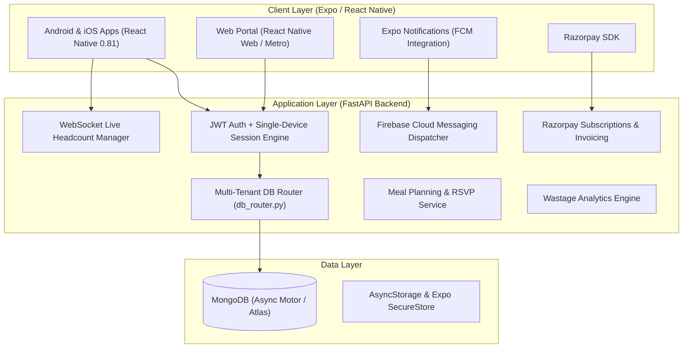

https://www.themessmate.com/

# 🍽️ MessMate — Smart Mess & Hostel Dining Management

[](https://fastapi.tiangolo.com)
[](https://reactnative.dev)
[](https://expo.dev)
[](https://www.mongodb.com)
[](https://www.typescriptlang.org)
[](https://python.org)
[](https://opensource.org/licenses/MIT)

> **MessMate** is an end-to-end, multi-tenant digital dining and mess management ecosystem designed for colleges, university hostels, paying guest (PG) accommodations, and institutional canteens. It empowers students to plan their daily meals, eliminates food waste through accurate predictive cooking headcounts, and provides mess administrators with automated stock planning, wastage auditing, billing, and push notifications.

---

## 🌟 Key Problem & Solution

* **The Problem**: Conventional hostels and college dining halls cook fixed quantities regardless of real student presence. Overcooking leads to massive financial losses and environmental food waste; undercooking leaves late arrivals without food. Furthermore, manual paper attendance creates billing discrepancies and unauthorized meal consumption.
* **The MessMate Solution**: 
  1. **Meal RSVP & Cutoff Engine**: Students indicate opt-in/opt-out status for each meal (Breakfast, Lunch, Snacks, Dinner) before strict cutoff times.
  2. **Predictive Cook Quantities**: Kitchen managers receive exact headcount forecasts with customizable buffer safety margins.
  3. **Wastage Auditing**: Track food cooked vs. consumed vs. disposed in kilograms with auto-calculated monetary loss.
  4. **Single-Device Security**: Prevents account sharing by automatically revoking previous sessions when logging in from a new device.

---

## 🏗️ Architecture & Technology Stack



### Technology Breakdown

| Component | Technology | Description |
| :--- | :--- | :--- |
| **Mobile & Web UI** | [React Native 0.81](https://reactnative.dev) + [Expo 54](https://expo.dev) | Cross-platform UI for Android, iOS, and Web |
| **Navigation** | [Expo Router 6](https://docs.expo.dev/router/introduction/) | Typed file-based routing architecture |
| **Styling & Theme** | Custom Eco-Minimalist Design Tokens | Apple-inspired fluid typography and responsive theme system |
| **Backend API** | [FastAPI](https://fastapi.tiangolo.com/) (Python 3.11+) | Async high-concurrency RESTful API & WebSockets |
| **Database** | [MongoDB](https://www.mongodb.com/) via [Motor](https://motor.readthedocs.io/) | Asynchronous, multi-tenant document database |
| **Push Notifications** | [Firebase Cloud Messaging](https://firebase.google.com/docs/cloud-messaging) | Real-time meal cut-off alerts and manager broadcasts |
| **Payments** | [Razorpay](https://razorpay.com/) | Automated subscription and mess fee collections |
| **Security** | Python Jose JWT + Session ID rotation | Single-active device verification & bcrypt password hashing |

---

## ✨ Features

### 🎓 Student Experience
* **Daily Meal Attendance**: Toggle meal participation (ON/OFF) for Breakfast, Lunch, Snacks, and Dinner with live countdowns to cutoff.
* **Weekly Cyclical Menus**: View daily breakfast, lunch, and dinner menus with dietary indicators (Vegetarian, Non-Vegetarian, Special Diets).
* **Eco Wastage Dashboard**: Track institutional food waste metrics and celebrate waste reduction milestones.
* **Push Reminders**: Receive automated alerts before meal marking windows close.
* **Account Privacy & Single Device Sync**: Clean, synchronized state across devices with strict single-device login protection.

### 🛡️ Mess Manager & Admin Experience
* **Live Headcount Dashboard**: Real-time visualization of expected diners vs. absentees per meal session.
* **Cooking Quantity Estimator**: Translates student RSVP count into precise raw ingredient amounts (kg rice, dal, flour, curries) plus buffer percentage.
* **Wastage Cost Calculator**: Log prepared food weight vs. leftover waste weight to compute waste percentages and monetary loss.
* **Student Roster & Verification**: Instant student onboarding, verification queues, and one-click student blocking/unblocking.
* **Broadcast Announcements**: Send instant campus-wide notifications directly to students' notification shades.
* **Billing & Fee Collection**: Manage monthly mess fee subscriptions and view payment transaction history.

---

## 📂 Project Directory Structure

```text
messmate/
├── backend/                        # FastAPI REST API & Async Server
│   ├── server.py                   # Main FastAPI server with all endpoints & WebSockets
│   ├── db_router.py                # Resilient multi-tenant MongoDB router
│   ├── security.py                 # Rate limiting and password encryption utilities
│   ├── ws_manager.py               # Real-time WebSocket connection manager
│   ├── requirements.txt            # Python backend dependencies
│   ├── Dockerfile                  # Container definition for backend
│   └── tests/                      # Pytest suite and integration tests
├── frontend/                       # React Native Expo Universal App
│   ├── app/                        # Expo Router file-based route definitions
│   │   ├── (auth)/                 # Login, register, OTP verification, password reset
│   │   ├── (student)/              # Home attendance, menu, wastage, and student settings
│   │   ├── (admin)/                # Headcount dashboard, cooking calc, students roster, billing
│   │   └── _layout.tsx             # Root layout with theme and auth providers
│   ├── src/
│   │   ├── api/                    # Axios/Fetch API client and session interceptors
│   │   ├── auth/                   # AuthContext with auto-logout on session invalidation
│   │   ├── components/             # Reusable cards, buttons, badges, and modals
│   │   └── theme.tsx               # Design token scales, dark/light theme definitions
│   ├── app.json                    # Expo project configuration and permissions
│   └── package.json                # Frontend JavaScript/TypeScript dependencies
├── docs/                           # Extended technical documentation
│   ├── api.md                      # API endpoints reference and examples
│   ├── architecture.md             # System architecture & multi-tenancy model
│   └── deployment.md               # Production deployment guide
├── start_messmate.ps1              # One-click Windows PowerShell launcher script
└── README.md                       # Main project documentation
```

---

## 🚀 Getting Started

### Prerequisites
* **Node.js**: v18.x or v20.x ([Download Node.js](https://nodejs.org))
* **Python**: v3.11, v3.12, or v3.14 ([Download Python](https://python.org))
* **MongoDB**: Local MongoDB community server running on port `27017` or a MongoDB Atlas URI ([Download MongoDB](https://www.mongodb.com/try/download/community))

---

### Step 1: Clone the Repository

```bash
git clone https://github.com/abu-devel0per/messmate.git
cd messmate
```

---

### Step 2: Configure Backend

1. Navigate to the backend directory:
   ```bash
   cd backend
   ```
2. Install Python dependencies:
   ```bash
   pip install -r requirements.txt
   ```
3. Set up environment variables:
   Create a `.env` file from the template:
   ```bash
   cp .env.example .env
   ```
   Configure the following key parameters in `.env`:
   ```env
   ENVIRONMENT=development
   MONGO_URL=mongodb://localhost:27017
   DB_NAME=messmate
   JWT_SECRET=your_super_secret_jwt_key_here
   JWT_ALGORITHM=HS256
   JWT_EXPIRE_MINUTES=10080
   ```
4. Start the backend server:
   ```bash
   python -m uvicorn server:app --host 127.0.0.1 --port 8000 --reload
   ```
   * Interactive Swagger documentation: **`http://127.0.0.1:8000/docs`**
   * ReDoc API specification: **`http://127.0.0.1:8000/redoc`**

---

### Step 3: Configure Frontend

1. Navigate to the frontend directory:
   ```bash
   cd ../frontend
   ```
2. Install dependencies:
   ```bash
   npm install
   ```
3. Set up environment variables:
   Create a `.env` file:
   ```env
   EXPO_PUBLIC_BACKEND_URL=http://localhost:8000
   EXPO_PUBLIC_API_URL=http://localhost:8000
   EXPO_PUBLIC_ENV=development
   ```
4. Run the frontend application:

   * **Web Browser**:
     ```bash
     npm run web
     ```
     Open [http://localhost:8081](http://localhost:8081) in your browser.

   * **Expo Go / Physical Device**:
     ```bash
     npx expo start
     ```
     Scan the displayed QR code with the **Expo Go** app on Android or iOS.

---

### ⚡ One-Click Startup (Windows)

On Windows machines, use the built-in startup script:
```powershell
powershell -ExecutionPolicy Bypass -File "start_messmate.ps1"
```
This script automatically:
1. Terminates any stale processes occupying port `8000`.
2. Verifies MongoDB is running on port `27017`.
3. Auto-detects your local LAN IP and updates `frontend/.env`.
4. Boots both the FastAPI server and the Expo development server concurrently.

---

## 🔒 Security & Single-Device Session Enforcement

MessMate implements server-enforced single active session verification:
1. When a user authenticates (`/api/auth/login`, `/api/auth/verify-email`, or `/api/auth/reset-password`), the backend rotates `active_session_id` to a new UUID and embeds it as a `sid` claim in the issued JWT.
2. Every incoming request validates the JWT's `sid` against the current database value.
3. If an account signs in on a new device, previous tokens immediately fail with:
   ```json
   {
     "code": "session_invalidated",
     "message": "You've been signed out because this account was signed in on another device."
   }
   ```
4. The client's `AuthContext` interceptor detects this response, clears local authentication tokens, and automatically redirects back to the login screen.

---

## 📡 API Reference Overview

| Method | Endpoint | Access | Description |
| :--- | :--- | :--- | :--- |
| `POST` | `/api/auth/register` | Public | Register a new student or admin account |
| `POST` | `/api/auth/verify-email` | Public | Verify registration with email OTP |
| `POST` | `/api/auth/login` | Public | Authenticate user, issue JWT, and rotate session |
| `GET` | `/api/auth/me` | Authenticated | Validate token and fetch current profile |
| `GET` | `/api/student/today` | Student | Retrieve today's meal menu & opt-in status |
| `PUT` | `/api/student/today` | Student | Update meal participation (ON/OFF) before cut-off |
| `GET` | `/api/admin/dashboard` | Admin | Get live headcount attendance and today's summary |
| `GET` | `/api/admin/cooking-quantities` | Admin | Calculate required ingredient weights based on RSVPs |
| `POST` | `/api/admin/wastage` | Admin | Record meal wastage in kg and calculate loss costs |
| `GET` | `/api/admin/students` | Admin | Query student roster with status filters |
| `PUT` | `/api/admin/students/{id}/status` | Admin | Approve, block, or unblock a student account |
| `POST` | `/api/notifications/broadcast` | Admin | Dispatch push notification to all students via FCM |

*Full API documentation and request/response schemas are accessible at `/docs` when the backend is running.*

---

## 🧪 Testing

The repository includes comprehensive backend tests and automated QA scripts:
```bash
# Run pytest backend test suite
cd backend
pytest tests/ -v

# Run comprehensive E2E journey test
python test_user_journey.py
```

---

## 📄 License

This project is licensed under the MIT License — see the [LICENSE](LICENSE) file for details.
