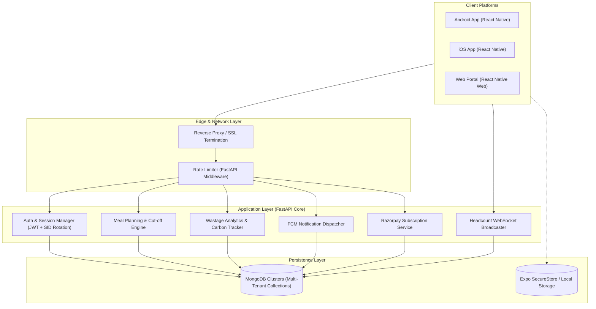
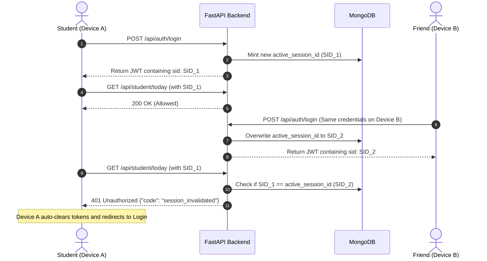

# 🏛️ MessMate — Architecture & System Design

MessMate is a multi-tenant cloud application engineered to streamline university and private hostel dining operations, reduce institutional food waste, and automate daily student attendance and kitchen inventory.

---

## 1. High-Level System Architecture

---

## 2. Multi-Tenancy Architecture

MessMate implements logical tenant isolation at the application and database layer:
* **Tenant Identification**: Every user, menu item, daily plan, wastage entry, and subscription is partitioned by `hostel` / `institution_or_hostel_name`.
* **Tenant Scoping Dependency**: All protected endpoints enforce the `require_tenant_access` dependency. Requests attempting cross-hostel access are blocked with HTTP 403 Forbidden.
* **Flexible Database Router (`db_router.py`)**: Supports single database tenancy as well as dynamic connection routing across multiple distributed database clusters.

---

## 3. Single-Device Session Security Protocol

To ensure students cannot share accounts or manipulate food attendance on behalf of absentees:

---

## 4. Key Database Collections

| Collection | Description | Primary Indexes |
| :--- | :--- | :--- |
| `users` | Student, Warden, and Admin accounts | `email` (unique), `hostel`, `active_session_id` |
| `daily_plans` | Daily meal participation flags (Breakfast, Lunch, Dinner, Snacks) | `user_id`, `date`, `hostel` |
| `menus` | Weekly cyclical meal items and serving timings | `hostel`, `day_of_week` |
| `wastage_logs` | Kitchen food cooked vs. left waste measurements | `hostel`, `date` |
| `notifications` | Push and in-app broadcast alerts | `hostel`, `created_at` |
| `subscriptions` | Mess subscription plans, dues, and Razorpay invoices | `hostel`, `status` |
